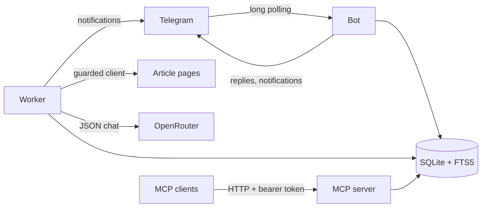
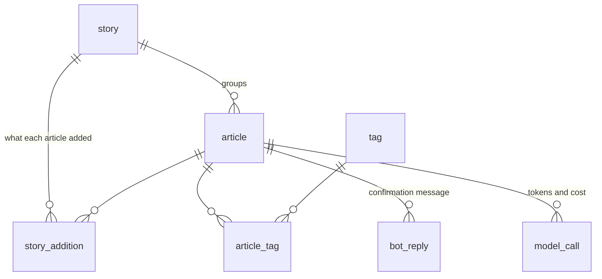
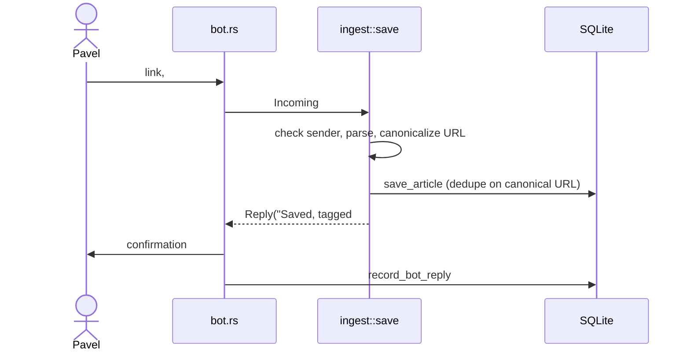
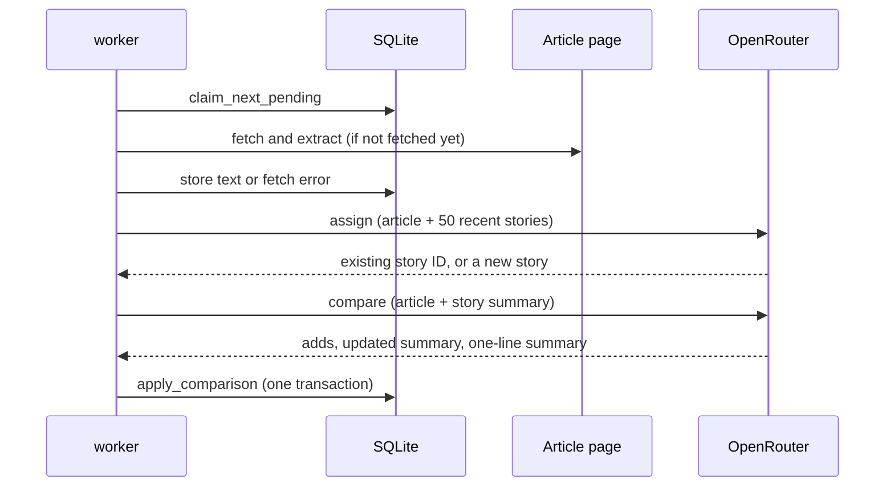
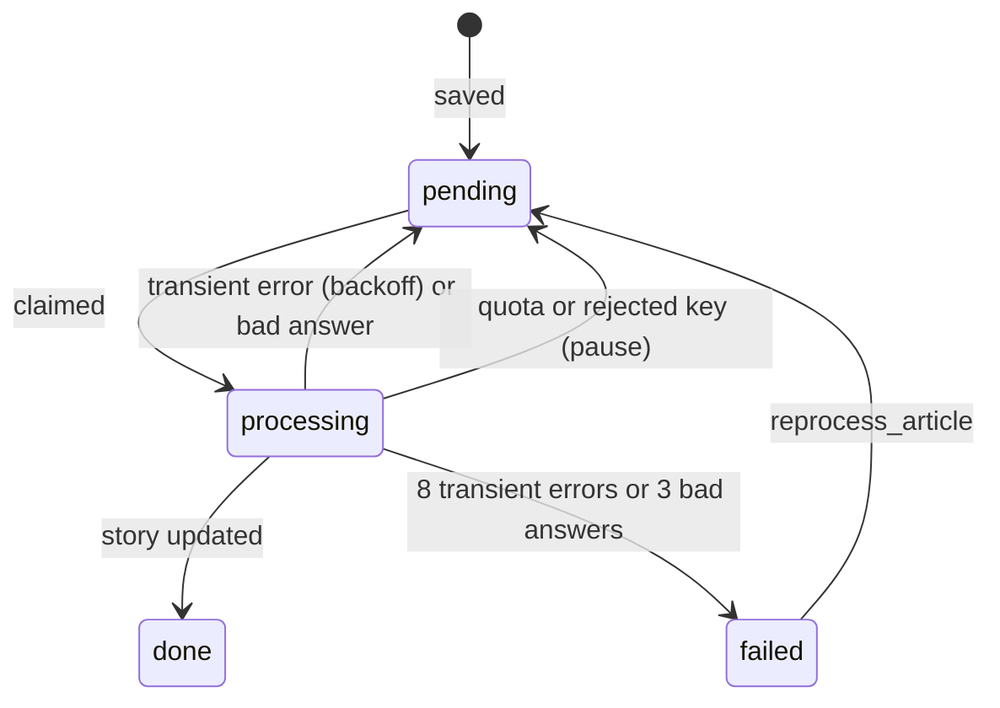

# Architecture

Reading list is one Rust binary with three long-running services that
share a SQLite database:

- the **bot** receives links over Telegram;
- the **worker** fetches the pages, summarizes them and groups them into
  stories;
- the **MCP server** lets agents read and triage the stories.

This page describes how the parts fit together and how a link moves
through them. Installation is covered in [deployment.md](deployment.md).

## Components

| Module | Role |
| ------ | ---- |
| `main.rs` | Reads `Config`, opens the DB, starts and supervises the three services, handles shutdown |
| `bot.rs` | Thin Telegram adapter (`teloxide`): converts updates and sends replies |
| `ingest/` | Message parsing, URL normalization and the save logic behind the bot |
| `worker.rs` | Queue loop: claim, fetch, summarize, merge into a story |
| `fetch.rs`, `net.rs` | Page download, Readability extraction and an SSRF-guarded HTTP client |
| `llm/` | The `Llm` trait, the OpenRouter client and the prompts |
| `status.rs` | Pure rules for retries, pauses and story status |
| `query.rs` | Read and triage logic behind the MCP tools |
| `mcp.rs` | `rmcp` tools served by `axum` at `/mcp`, behind bearer middleware |
| `db/` | All SQL, as compile-time checked `sqlx` queries |

### Design rules

- **Pure logic apart from I/O.** Parsing, normalization, prompt building
  and status rules are plain functions with unit tests. The I/O modules
  (`bot.rs`, `worker.rs`, `mcp.rs`) only connect them.
- **SQL lives in `src/db/` only.** The schema lives in `migrations/`.
- **Secrets come from environment variables.** `Config` redacts them in
  its `Debug` output.
- **Untrusted URLs use a guarded client.** `WebClient` connects only to
  public addresses, so a saved link cannot reach the home LAN or this
  host. It checks both resolved addresses and IP-literal URLs, including
  every redirect target. OpenRouter, a fixed trusted endpoint, gets a
  plain client.

## Data model

| Table | Holds |
| ----- | ----- |
| `article` | One saved URL: canonical and original URL, extracted text, note, share text, fetch and process status, retry counters |
| `story` | A group of articles: title, kind (`news` or `idea`), running summary, read status |
| `story_addition` | What one article added to its story; empty text means nothing new |
| `tag`, `article_tag` | `#tags` from the messages |
| `bot_reply` | Maps a bot confirmation message to its articles, so a reply to it becomes a note |
| `model_call` | Purpose, model, tokens and cost of every OpenRouter call |
| `article_fts`, `story_fts` | FTS5 indexes, kept in sync by triggers |

Timestamps are UTC text, so they compare correctly as strings.

## Saving a link

The bot does no network work beyond resolving known URL shorteners, so
it replies within a second. Everything slow happens later in the worker.

- Messages from anyone except `TELEGRAM_ALLOWED_USER_ID` are ignored.
- A link that is already saved only gains the new tags.
- A **reply** to a bot confirmation adds a note and tags to the articles
  in that confirmation instead of saving anything new.
- Canonical URLs have a lowercase host and no fragment, tracking
  parameters or trailing slash. They are the deduplication key.

## Processing an article

The worker handles one article at a time. Each article costs two model
calls: one **assigns** it to a story and one **compares** it with that
story.

- **Assign** sees the 50 most recent stories and either picks one or
  proposes a new story with a title, kind and summary.
- **Compare** returns what the article adds, the updated story summary
  and a one-line summary of the article. An article that adds
  information makes a `read` story `unread` again. A `dropped` story
  stays dropped.
- A failed fetch does not stop the pipeline. The article is summarized
  from its URL, note and share text, and the error is kept in
  `fetch_error`.

## Failure handling

`status.rs` decides what each error means. It has no I/O, so every rule
is a unit test.

| Error | Examples | Treatment |
| ----- | -------- | --------- |
| Pause | HTTP 402 quota, 401/403/404 key or model | Release the article, pause all summaries, notify once |
| Transient | timeouts, HTTP 5xx, 429, DB errors | Retry with backoff from 1 minute, doubling up to 1 hour, at most 8 times |
| Attempt | the model's JSON does not parse or names an unknown story | Retry at most 3 times, then mark failed |

An article left in `processing` by a crash or shutdown is reset to
`pending` at the next start (`reset_stuck_processing`).

## Reading and triage over MCP

The MCP server uses streamable HTTP on `MCP_LISTEN_ADDR` (default
`0.0.0.0:8787`) at `/mcp`. Every request needs the bearer token, which
is compared in constant time.

| Tool | Purpose |
| ---- | ------- |
| `list_stories` | Stories by status, age, kind and tag; unread from the last 7 days by default |
| `get_story` | Summary plus each article's URL, what it added and whether it is new |
| `get_article` | Full extracted text, note, share text, tags and errors |
| `search` | FTS5 keyword search over stories and articles |
| `set_story_status` | Mark a story unread, read or dropped |
| `list_failed` | Articles that could not be fetched or processed |
| `reprocess_article` | Queue an article again with a fresh retry budget |

A typical session is `list_stories`, then `get_story`, then
`get_article` for full text, and finally `set_story_status`. IDs are
stable. The `#3`-style numbers an agent shows are for display only.

## Startup and shutdown

`main` installs signal handlers first, because in a container the
process is PID 1 and the kernel drops signals PID 1 has no handler for.
It then reads `Config`, opens the database, requeues stuck articles and
starts the three services under one supervisor.

On SIGTERM or SIGINT the supervisor cancels a shared
`CancellationToken`, gives the services 8 seconds to drain and then
gives blocking tasks 1 second more. A service that stops by itself or
panics counts as a failure, and the process exits with a non-zero
status. The Quadlet's
`StopTimeout` (10 s) must stay above the 9-second total.
